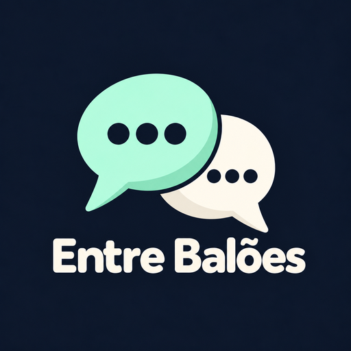

# Entre Balões — Tradução local de WEBTOON



App Android em Flutter + Kotlin com OCR e tradução inglês → português sobre a tela visível, com controle flutuante para iniciar e pausar.

O modo **Online** usa Gemini Flash ou Flash-Lite, com chave salva por criptografia no aparelho. Somente os textos reconhecidos, o contexto visível e o glossário são enviados à API. A faixa gratuita depende da elegibilidade e das cotas do projeto.

O modo padrão **Rápido** usa Google Translate offline, via ML Kit no aparelho. O modelo é preparado pelo Wi-Fi e depois as frases são traduzidas localmente. Ele oferece português (`pt`), sem uma opção regional específica. Consulte a [documentação do Google Translate](https://cloud.google.com/translate) e as [regras de atribuição do ML Kit](https://developers.google.com/ml-kit/language/translation/translation-terms).

O modo **LLM** usa **Hy-MT2 1.8B Q4_K_M**, especializado em tradução, executado por llama.cpp na CPU. Os pesos opcionais ocupam aproximadamente 1,13 GB, com retomada e SHA-256 verificado. Na versão 1.6.0, ele substitui o Qwen após comparações reais de velocidade e qualidade no POCO. Os balões aparecem um por vez, com cache de prompt e preparação antecipada. Veja as medições e limitações em [desempenho offline](docs/LOCAL_PERFORMANCE.md).

## Usar

1. Compile e instale o APK conforme as instruções abaixo. O arquivo gerado fica em `build/app/outputs/flutter-apk/app-release.apk`.
2. Abra o app, autorize a sobreposição e ative o serviço de acessibilidade.
3. Escolha Rápido (ML Kit), LLM (Hy-MT2 offline) ou Online (Gemini). Prepare o modelo escolhido. **Testar tradução no aparelho** mede a tradução e informa separadamente o tempo de preparação do modelo local.
4. No modo online, salve a chave e teste a conexão. O atalho para abrir o WEBTOON é opcional.
5. Inicie a sessão e autorize a captura do Android. A sessão começa **pausada**. Abra o conteúdo e toque em **Traduzir** no controle flutuante.
6. Use **Pausar** para cancelar o processamento e esconder as traduções; toque novamente em **Traduzir** para retomar. Arraste pela alça para mover o controle. O botão **×** e a notificação encerram a sessão.

Enquanto a leitura estiver liberada, as traduções somem no primeiro evento de movimento. Após 550 ms sem rolagem, o app captura, faz OCR e procura as frases no SQLite. Apenas frases novas chegam ao modelo. O controle flutuante é ocultado durante a captura para não entrar no OCR. Mudanças de conteúdo são agrupadas e não cancelam uma captura ou tradução em andamento. Imagens ficam no aparelho; no modo online os textos são enviados ao Gemini.

O leitor do app oficial apresentou `FLAG_SECURE` e captura preta, confirmado por ADB e screenshot comum. Com autorização do usuário, o alvo mudou para Chrome. O Qwen completou seis regiões em 29.310 ms na versão inicial; uma tentativa posterior com DOTPROD/FP16 levou 9.287 ms, com uma região em cache e duas novas (cargas diferentes).

O modo rápido completou uma página com três regiões em **795 ms**, sendo uma em cache e duas novas, além do debounce de 550 ms. O teste inicial de uma frase levou 1.199 ms. Isso confirma a meta de cinco segundos nessa amostra no POCO; não é uma garantia para todas as páginas. Na versão seguinte, reticências e texto em maiúsculas são normalizados, nomes do glossário são protegidos e URLs ficam fora da tradução. Essas correções possuem cache separado dos resultados anteriores.

O controle manual não limita o site ou navegador. Quando a leitura está liberada, o conteúdo visível em aplicativos compatíveis com captura pode ser processado. Pause antes de abrir informações que não queira enviar ao Gemini. Bloquear a tela pausa a leitura; ela só retoma pelo botão. Conteúdos protegidos pelo Android continuam sem captura.

## Compilar e testar

```powershell
./scripts/prepare_llama.ps1
flutter pub get
flutter analyze
flutter test
flutter build apk --release --target-platform android-arm64
```

Veja [compilação e dependências](docs/BUILD.md), [resultado das verificações](docs/IMPLEMENTATION_STATUS.md) e [validação no POCO](docs/DEVICE_VALIDATION.md).

`lib/core/` contém OCR, agrupamento, cache e coordenação. `lib/ui/` contém onboarding e desenho dos balões. Serviços, canais, download e integração Kotlin ficam no pacote Android do app; o JNI/C++ fica em `android/app/src/main/cpp/`. Os pesos e ferramentas de teste ficam em `.tools`, ignorado pelo Git.

O cache usa o modelo e a versão do prompt na chave, normaliza espaços/quebras de linha e preserva caixa e pontuação. As capturas são temporárias no armazenamento privado, com remoção após o OCR. Imagens e traduções não entram no backup automático.

Nos ajustes, o glossário do modo rápido preserva nomes e termos (inicialmente `Nest`, usado no episódio de teste). A mudança do glossário altera o namespace do cache. Traduções automáticas fornecidas pelo Google podem conter erros; o app inclui o aviso e a atribuição visual exigidos pelo fornecedor. Nenhuma frase é enviada para a Cloud Translation API.
